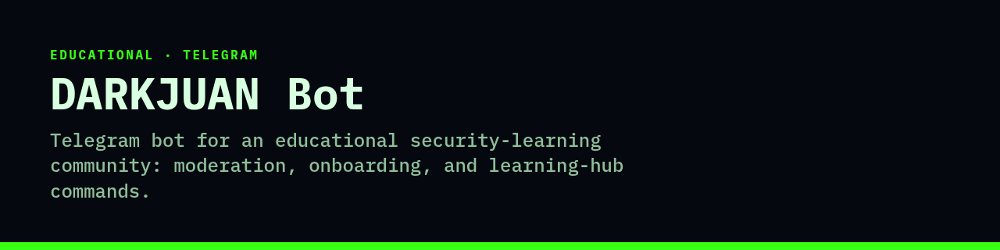

<p align="center">
  
</p>

# DARKJUAN Bot

**Telegram bot for an educational security-learning community: moderation, onboarding, and learning-hub commands.**

[](#license)


Python bot using python-telegram-bot, SQLAlchemy/aiosqlite, and structlog. Focused on group moderation and educational content with legal disclaimers. **Security: the bot reads secrets from the environment. `.env.example` contains placeholders only. A bot token was previously committed in that file and is still in git history — revoke it in @BotFather before any history rewrite.**

## Features

- Onboarding (`/start`, `/rules`, `/agree`) and roles
- Safety policies, link checks, rate limiting / spam detection
- Learning hub commands (`/resources`, `/lab`, `/ctf`, `/disclosure`, `/glossary`, `/attacks`, `/tools`)
- `/report` to mods with audit logging (no message bodies stored)
- `/redact` helper to mask secrets before sharing

## Tech stack

- Python 3.11+
- python-telegram-bot 20.x
- SQLAlchemy + aiosqlite
- structlog
- pytest

## How to run

```bash
python -m venv .venv
source .venv/bin/activate
pip install -r requirements.txt
cp .env.example .env   # then set real values in .env only; never commit that file
python -m bot.main
```

Tests: `pytest`.

## Environment variables

Names only. Never commit values.

- `TELEGRAM_BOT_TOKEN`
- `ADMIN_USER_IDS`
- `MOD_USER_IDS`
- `DATABASE_URL`
- `LOG_LEVEL`

## Status

Public. Educational community bot. `.env.example` uses placeholders. Rotate the bot token that was committed earlier; it remains in git history until a purge, and a purge does not revoke it.

## License

All rights reserved.

## Download

Source archives are published on the [Releases page](https://github.com/Awkward8787/darkjuan-bot/releases); the latest release carries `darkjuan-bot-v0.1.0.zip`. The archive excludes environment and git files.

### Install & run
```bash
unzip darkjuan-bot-v0.1.0.zip
cd darkjuan-bot
python -m venv .venv
source .venv/bin/activate
pip install -r requirements.txt
# Create a .env with your own values (see "Environment Variables" above):
# TELEGRAM_BOT_TOKEN, ADMIN_USER_IDS, MOD_USER_IDS, DATABASE_URL, LOG_LEVEL
python -m bot.main
```
Requires Python 3.11+ and a Telegram bot token.
